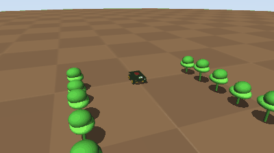
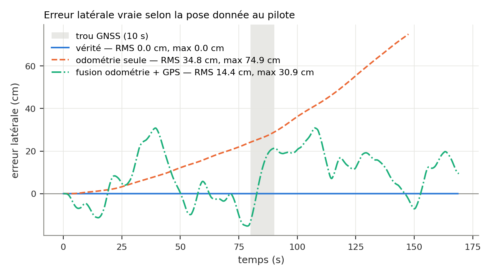

# FieldNav

Un robot agricole simulé suit un rang de culture **à partir d'une pose estimée** : odométrie
bruitée et GPS bruité fusionnés, pilotage par pure pursuit, télémétrie dans un format documenté.



*Run réel (seed 42, accéléré ×7) : châssis LAFVIN 4WD simulé dans MuJoCo, rang droit de 50 m,
GPS σ = 1 m avec 20 % de mesures perdues et un trou GNSS de 10 s au milieu du rang.*


Projet de M2 (Réseaux et Objets Connectés, Perpignan), support d'un mémoire et d'un dossier de
thèse. Les décisions sont tracées dans [docs/decisions/](docs/decisions/).

## Résultats

Rang droit de 50 m, GPS σ = 1 m, 20 % de pertes, trou GNSS de 10 s (80 à 90 s), seed 42 :

| Pose donnée au pilote | Distance parcourue | Erreur latérale RMS | Erreur latérale max |
|---|---|---|---|
| vérité terrain (référence) | 49,95 m, bout du rang | 0,0 cm | 0,0 cm |
| odométrie seule | **43,7 m, sortie de rang** | 34,8 cm | 75 cm |
| **fusion odométrie + GPS** | 49,95 m, bout du rang | **14,4 cm** | 30,9 cm |



**Sur 11 seeds** (1 à 10 et 42), la fusion termine le rang sans en sortir dans **11 cas sur 11**
(erreur max ≤ 54 cm, limite 75 cm). Son erreur latérale RMS va de 13,0 à 30,8 cm, **médiane
18,1 cm** : l'objectif fixé par l'[ADR 0005](docs/decisions/0005-feature-cible.md) (RMS < 15 cm)
n'est atteint que pour 3 seeds sur 11. Il est conservé tel quel. Le plancher vient du **biais du
GPS** (marche aléatoire de 0,02 m/√s, soit ≈ 26 cm en moyenne sur 170 s) : le GPS étant le seul
capteur absolu, aucun filtre ne peut l'observer. Analyse complète dans la section « Résultat
mesuré » de l'ADR 0005.

## Démarrage rapide

Prérequis : CMake ≥ 3.20, Ninja, un compilateur C++20 (gcc 11+ ou clang 14+ ; sous Windows,
MinGW-w64 de WinLibs), Python 3.10+, Git. MuJoCo 3.16 et GoogleTest sont téléchargés par CMake.

```bash
git clone https://github.com/GilS97/FieldNav.git
cd FieldNav
python -m venv .venv
.venv/Scripts/python -m pip install -r scripts/requirements.txt   # Linux : .venv/bin/python
```

1. **Compiler et tester**

   ```bash
   cmake --preset debug
   cmake --build --preset debug
   ctest --preset debug
   ```

2. **Lancer une mission** (≈ 6 s)

   ```bash
   build/debug/apps/fieldnav_run --pose-source fusion --seed 42 --gps-outage 80,90 --out run.csv
   ```

3. **Tracer les figures**

   ```bash
   .venv/Scripts/python scripts/plot_run.py run.csv
   ```

Pour comparer vérité, odométrie et fusion : `bash scripts/run_matrix.sh build/debug`, puis
`plot_run.py --compare results/<date>/row_straight_*_seed42.csv`.
Options de `fieldnav_run` : `--help`. Codes retour : 0 ok, 1 sortie de rang, 2 configuration.

## Architecture

```
          ┌──────────────── simulation MuJoCo (500 Hz) ────────────────┐
          │  scenes/row_straight.xml : robot LAFVIN 4WD + rang de 50 m  │
          └──────┬───────────────────────────────────────┬─────────────┘
       roues mesurées                             position vraie
                 │                                       │
     sensors::WheelNoise (±2 %)              sensors::GpsSim (σ 1 m, biais,
                 │                            pertes 20 %, trou GNSS)
     odometry::wheelsToTwist → (v, ω)                    │
                 │                                       │
     odometry::DiffDriveOdometry (Euler) ──► estimation::ComplementaryFuser (α = 0,05)
                                                         │ pose estimée
                                   path::Path (erreur latérale, lookahead)
                                                         │
                                   control::purePursuit (50 Hz) → (v, ω)
                                                         │
                                   odometry::twistToWheels → consignes des roues ──► simulation
                                                         │
                                   telemetry::TelemetryWriter (10 Hz, CSV / JSONL)
```

| Dossier | Rôle |
|---|---|
| `src/odometry/` | pose 2D, odométrie différentielle (Euler), cinématique roues ↔ (v, ω) |
| `src/sensors/` | bruit des roues, GPS simulé (biais en marche aléatoire, pertes, trou GNSS) |
| `src/estimation/` | fusion complémentaire odométrie + GPS (corrige x et y, jamais le cap) |
| `src/path/` | référence du rang, erreur latérale signée, point visé |
| `src/control/` | pure pursuit (κ = 2 sin α / L_d) |
| `src/sim/` | simulation MuJoCo du robot (pose vraie, vitesses de roues) |
| `src/mission/`, `apps/` | boucle complète et programme `fieldnav_run` |
| `src/telemetry/` | télémétrie, format décrit dans [docs/telemetry_format.md](docs/telemetry_format.md) |
| `libs/sensor_utils/` | statistiques (RMS, max) en C++20 |
| `scenes/`, `data/`, `scripts/` | scènes générées, trajectoires de référence, outils Python |

Reproductible : tout l'aléa passe par des `std::mt19937` seedés ; même seed, même télémétrie
(octet pour octet sur une même plateforme).

## Limites connues

- Le rang courbe (rayon 100 m) est générable (`scripts/gen_row_scene.py --radius 100`) mais pas
  encore validé en boucle fermée.
- Le robot ne fait pas demi-tour en bout de rang (hors périmètre jusqu'en 2027).
- Les dimensions du châssis sont celles d'un kit LAFVIN standard, pas encore mesurées sur le robot.

## Licence

Apache 2.0 — voir [LICENSE](LICENSE).
